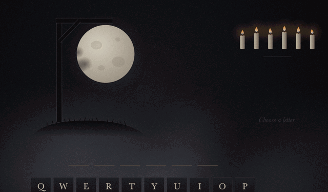
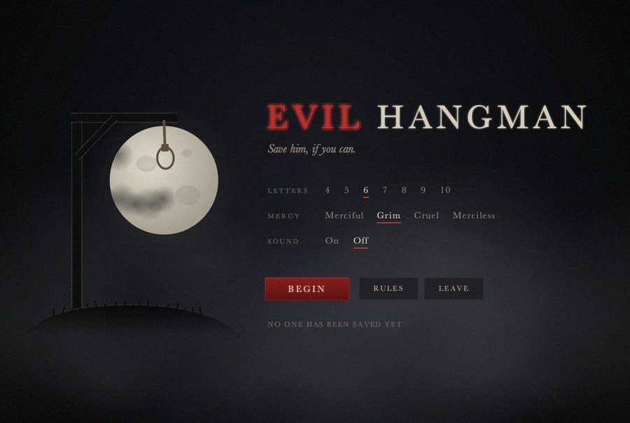
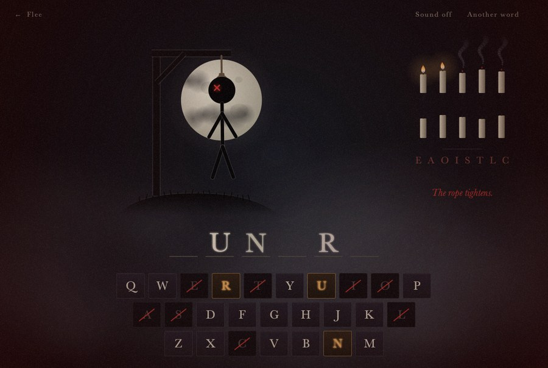
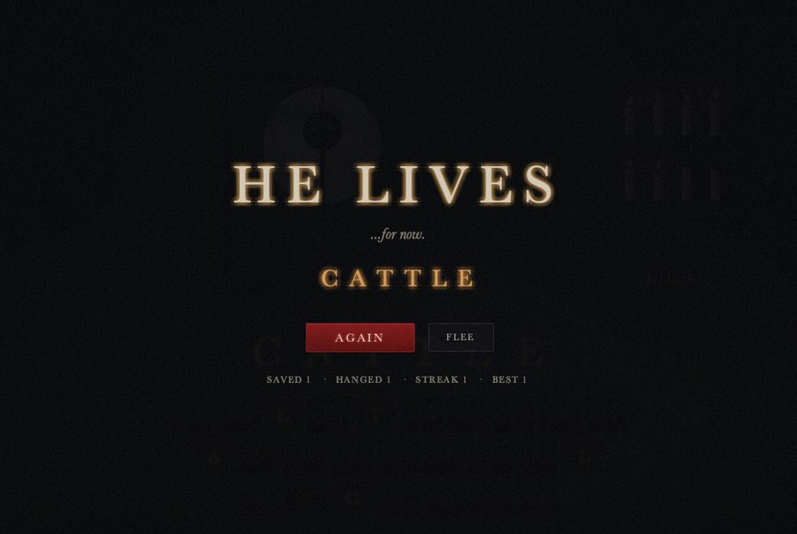
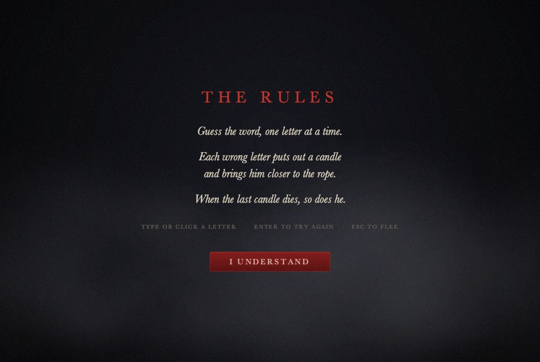
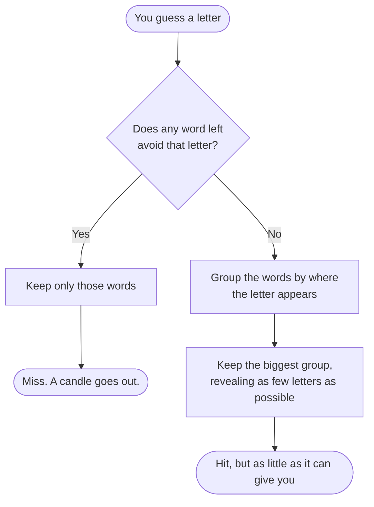

<p align="center">
  
</p>

<p align="center">
  <a href="#play-it"></a>
  
  
  <a href="LICENSE"></a>
</p>

<p align="center">
  <a href="#play-it">Play it</a> &nbsp;·&nbsp;
  <a href="#what-waits-for-you">Features</a> &nbsp;·&nbsp;
  <a href="#the-secret">The secret</a> &nbsp;·&nbsp;
  <a href="#under-the-floorboards">Code</a>
</p>

<br />

<p align="center">
  
</p>

<p align="center">
  
</p>

## Play it

All you need is Java 14 or newer. From the project folder:

```sh
javac -d out src/*.java
java -cp out Driver
```

Or open the project in IntelliJ, open `src/Driver.java` and click the green run arrow next to `main`.

Guess the word one letter at a time, by typing or by clicking the keys. Each wrong letter puts out a candle. When the last candle dies, so does he.

<table>
  <tr>
    <td><kbd>A</kbd> – <kbd>Z</kbd></td><td>Guess a letter</td>
    <td><kbd>Enter</kbd></td><td>Play again</td>
    <td><kbd>Esc</kbd></td><td>Flee to the menu</td>
  </tr>
</table>

## What waits for you

<table>
  <tr>
    <td width="50%"></td>
    <td width="50%"></td>
  </tr>
  <tr>
    <td><b>An empty noose, waiting.</b> Choose the word length and how much mercy you deserve.</td>
    <td><b>The walls close in.</b> As the candles go out, the edges of the screen bleed red.</td>
  </tr>
  <tr>
    <td width="50%"></td>
    <td width="50%"></td>
  </tr>
  <tr>
    <td><b>He lives… for now.</b> Your saved and hanged record follows you between games.</td>
    <td><b>The rules, and nothing more.</b> The game never tells you its secret.</td>
  </tr>
</table>

<table>
  <tr>
    <td width="50%" valign="top">
      <h4>Candles, not hearts</h4>
      Every miss snuffs one out with a red ember and a curl of smoke. On the last one you'll hear a heartbeat.
    </td>
    <td width="50%" valign="top">
      <h4>A living scene</h4>
      Clouds pass over the moon, fog drifts, the light flickers and the film grain crawls. The body sways on the rope and jolts with every mistake.
    </td>
  </tr>
  <tr>
    <td valign="top">
      <h4>Sound, synthesised from scratch</h4>
      A low drone and wind, a thud for each miss, a cracked bell for each hit, and a toll when it's over. No audio files, and you can turn it off.
    </td>
    <td valign="top">
      <h4>Four levels of mercy</h4>
      <i>Merciful</i> (12 candles), <i>Grim</i> (10), <i>Cruel</i> (8) or <i>Merciless</i> (6), with words from 4 to 10 letters long.
    </td>
  </tr>
  <tr>
    <td valign="top">
      <h4>8,000+ words</h4>
      Filtered from a word-frequency list. A word that was the answer won't come back until every other word of that length has been used.
    </td>
    <td valign="top">
      <h4>No spoilers inside</h4>
      The game never explains itself. You'll have to work out what it's doing on your own… or open the section below.
    </td>
  </tr>
</table>

<p align="center">
  
</p>

## The secret

> [!CAUTION]
> Playing it first is more fun. Open this only once you've been hanged a few times.

<details>
<summary><b>How the game cheats</b></summary>

<br />

**There is no secret word.**

The game keeps a list of every word that still fits what you've seen. Each time you guess, it sorts those words into groups by where your letter would appear, and keeps whichever group hurts you most:



#### A worked example

Say seven 4-letter words are left, and you guess **E**:

| Where E appears | Words | |
| :-- | :-- | :-- |
| `_ E _ _` | BEAR, DEAL | |
| `E _ _ _` | ECHO | |
| `_ E E _` | HEED | |
| *nowhere* | MOTH, CROW, LOUD | ← **kept: any words that dodge the letter win** |

That's a miss. Now you guess **O**, and every word left contains it, so the game has to give you something:

| Where O appears | Words | |
| :-- | :-- | :-- |
| `_ O _ _` | MOTH, LOUD | ← **kept: the bigger group** |
| `_ _ O _` | CROW | |

You see `_ O _ _`, and the game still has two words to slip between.

#### It plays fair

It cheats, but it never lies. The word can change after every guess, but it never becomes one that contradicts a letter you've already tried. Every word still in play has your correct letters exactly where they're shown, and none of your wrong ones. So the word revealed at the end fits every guess you made. The test suite checks this rule after every single guess, across more than a thousand simulated games.

</details>

## Under the floorboards

```text
src/
├── Driver.java          Starts the game
├── EvilHangman.java     The rules: word families, hits, misses, win and loss. No UI.
├── WordBank.java        Loads and filters wordlist.txt, serves words by length, avoids repeats
├── GameWindow.java      The window; switches between menu, rules and game
├── MenuScreen.java      ┐
├── HowToScreen.java     ├ The three screens
├── GameScreen.java      ┘
├── HangmanView.java     The moonlit gallows and the figure
├── InfoPanel.java       Candles, wrong letters and whispers
├── WordView.java        The word, letter by letter
├── KeyboardPanel.java   The stone keyboard
├── ResultOverlay.java   HANGED / HE LIVES
├── ScenePanel.java      Fog, vignette, flicker, grain, lightning, the red tint
├── Sound.java           Every sound, synthesised in code
├── Theme.java           Colours, fonts and drawing helpers
└── …                    Buttons, title, settings and the saved record
test/
└── EvilHangmanTest.java Rules, word list and the fairness check
```

Every image in the game is drawn with Java2D and every sound is generated sample by sample, so the only file the game needs is `wordlist.txt`. Settings and your record are saved with Java's built-in `Preferences`.

### Run the tests

No test framework is needed:

```sh
javac -d out src/*.java test/*.java
java -cp out EvilHangmanTest
```

```text
  simulated 1050 games across lengths [4, 5, 6, 7, 8, 9, 10]
All 7851 tests passed.
```

## Origins

Evil Hangman began as a summer project by Eddie Ubri Jr, to bring together everything from CMPSC 221 (Object Oriented Programming with Web Applications) in one Java Swing GUI. It has since been rebuilt from the ground up with a new engine, a new look, and sound.

<br />

<p align="center">
  
</p>

<p align="center">
  <sub>Released under the <a href="LICENSE">MIT License</a>.</sub>
</p>
